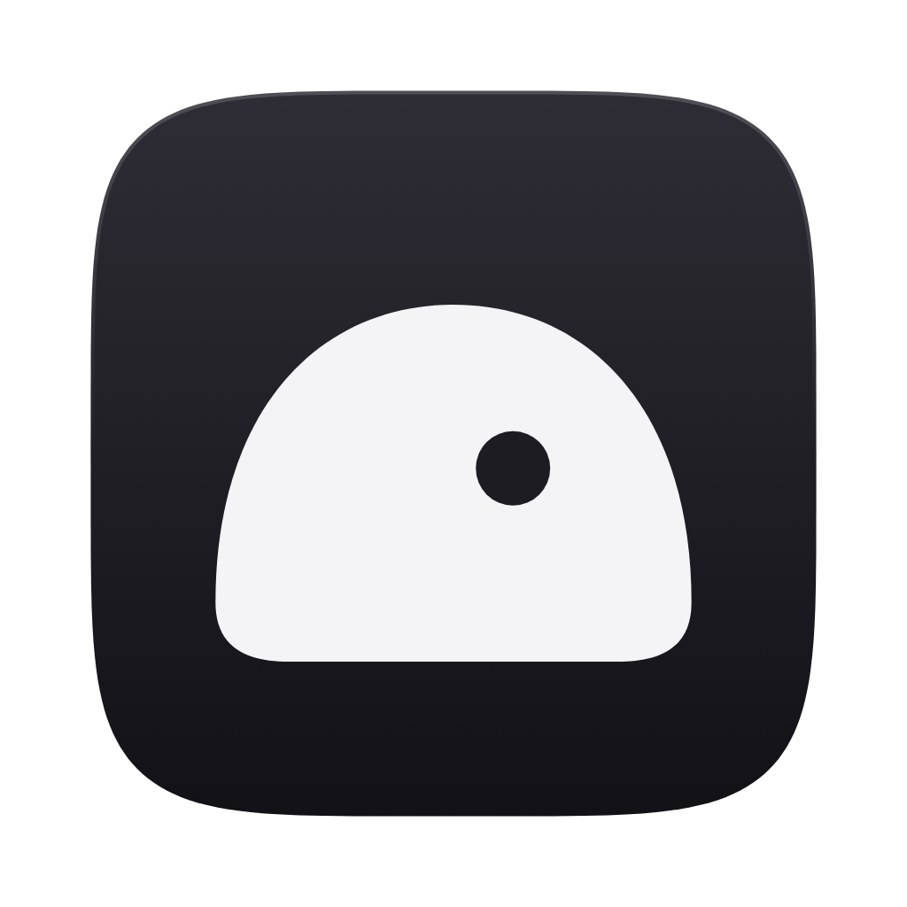

# Mochi

A desktop workspace for running many coding agents at once. Give each thread a goal, let Claude Code and Codex work toward it in their own worktrees, and step in only when something needs you.

> Status: prototype. Most of the UI is real; agents run on a simulated `demo` adapter until the runtime lands ([RUNTIME.md](RUNTIME.md)).

## What it does

- **Threads with goals.** Every thread has a goal broken into steps, with progress, pace and an ETA. The agent's own plan is mapped onto those steps, never the other way round.
- **Attention queue.** Approvals, questions and overlaps from every thread land in one queue, and in the thread's composer, so you answer them where you are.
- **Drift guard.** A prompt that wanders from the thread's goal gets flagged before it runs.
- **Metro board.** One line per thread, one station per step; threads touching the same files meet at an interchange so overlaps show up before they conflict.
- **Side pane.** Browser preview, diffs, terminal, files, iOS simulator and a side chat, in browser-style tabs that pop out into a floating window.
- **Multitasking.** Splits, pinned threads, Orbit (a radial switcher), and pinned threads you swipe between.
- **Your own logins.** Mochi drives your installed Claude Code and `codex`. It never logs in for you and never sees your credentials.

## Run it

Needs Node 24 and pnpm.

```bash
pnpm install
```

```bash
pnpm electron:dev
```

The web build runs the same UI with mocked desktop features:

```bash
pnpm dev
```

## Scripts

| Command               | Does                                                                                            |
| --------------------- | ----------------------------------------------------------------------------------------------- |
| `pnpm dev`            | Web build on Vite                                                                               |
| `pnpm electron:dev`   | Desktop app with hot reload                                                                     |
| `pnpm electron:build` | Unsigned macOS `.app` in `apps/desktop/release/`                                                |
| `pnpm typecheck`      | Renderer, Electron main, Core and relay, with tsc-rs and its Effect diagnostics                 |
| `vp run test`         | Vitest over every `*.test.ts`; `vp run test --changed <ref>` runs only the tests a diff reaches |
| `pnpm artifact`       | Single-file HTML build in `apps/desktop/artifact/`                                              |

## Layout

```
apps/desktop/electron/     main process: window, IPC, pty, git, fs, browser views, simulator
apps/desktop/src/host/     typed bridge to the main process, with web mocks
apps/desktop/src/store/    state slices: threads, queue, panes, layout, ui
apps/desktop/src/pane/     side pane tabs
apps/desktop/src/runtime/  agent adapters (demo today; Claude Agent SDK and Codex app-server next)
apps/desktop/src/goals/    goal editing, templates, drift guard
packages/{schema,domain,core}  wire schemas, renderer-free shared modules, Core
```

## Docs

- [DESIGN.md](DESIGN.md): the design system: tokens, type, layout, components
- [RUNTIME.md](RUNTIME.md): how threads run real Claude Code and Codex agents
- [CHECKLIST.md](CHECKLIST.md): what's built and what's left
- [SESSIONS.md](SESSIONS.md): how the build is split across parallel sessions

## Dev MCP

Opt in when launching a desktop dev build. Use a separate data directory to keep test tasks apart from your daily workspace:

```bash
MOCHI_DEV_MCP=1 MOCHI_USER_DATA=/tmp/mochi-dev pnpm electron:dev
```

The app writes `/tmp/mochi-dev/dev-mcp.json` with its MCP URL and process id. Configure an external MCP client's HTTP server with that URL, or use the included client:

```bash
node apps/desktop/scripts/dev-mcp.mjs /tmp/mochi-dev/dev-mcp.json inspect '{}'
node apps/desktop/scripts/dev-mcp.mjs /tmp/mochi-dev/dev-mcp.json start_task '{"provider":"codex","prompt":"Explain why 2 + 2 is 4"}'
node apps/desktop/scripts/dev-mcp.mjs /tmp/mochi-dev/dev-mcp.json inspect '{"threadId":"new-1","limit":50}'
node apps/desktop/scripts/dev-mcp.mjs /tmp/mochi-dev/dev-mcp.json continue_task '{"threadId":"new-1","text":"Explain 3 + 3 next"}'
```

Use the returned task id in subsequent calls. Goals start empty; the working agent proposes one after research. `accept_goal` accepts that researched proposal for a test task without verifying its criteria. `start_task` accepts an optional absolute `project` folder and uses the selected profile's account and permission defaults. `inspect` exposes paginated transcript entries, goal criteria, proposals, todos, turn reports, pending questions, verdicts and next actions. PR state is the last recorded state. Continue only idle tasks; running and settled tasks are refused.

This endpoint is disabled in packaged builds, binds only to loopback, rejects browser origins and uses a new secret URL each launch. The discovery file is owner-readable only and is removed on normal exit. A fresh data directory needs an account connected through Settings before real agent tasks can run.
